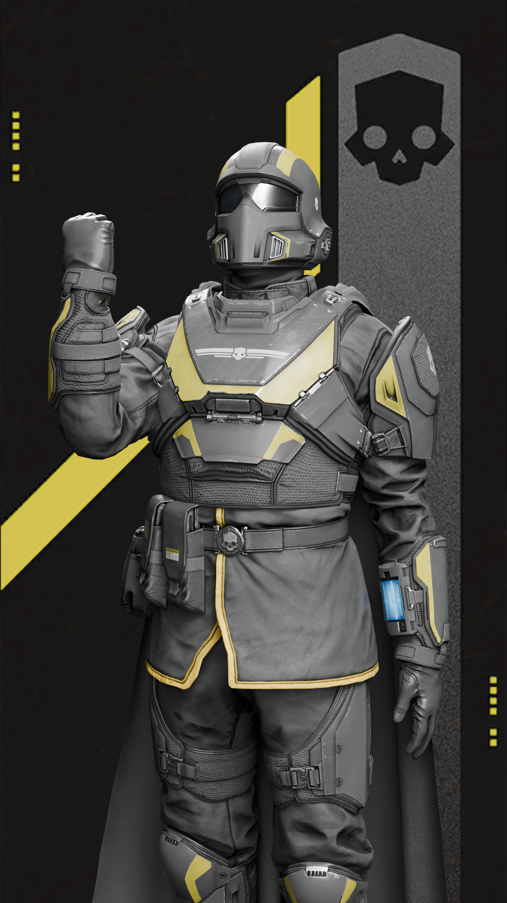
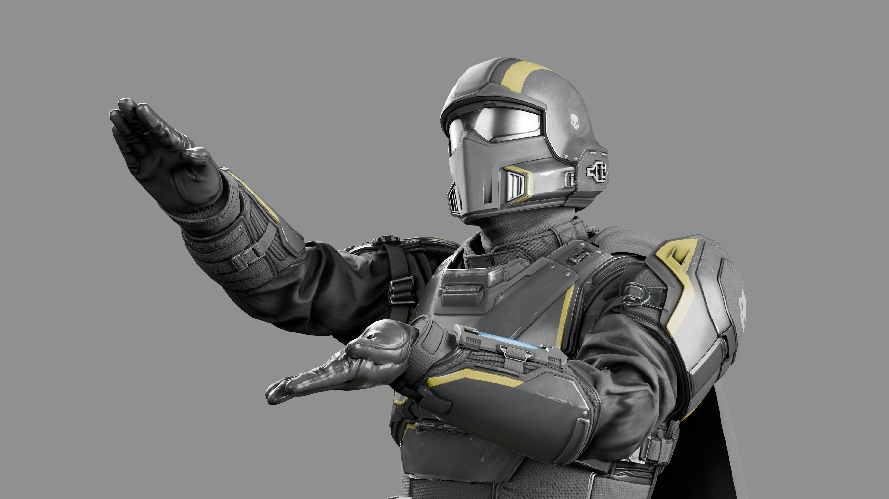
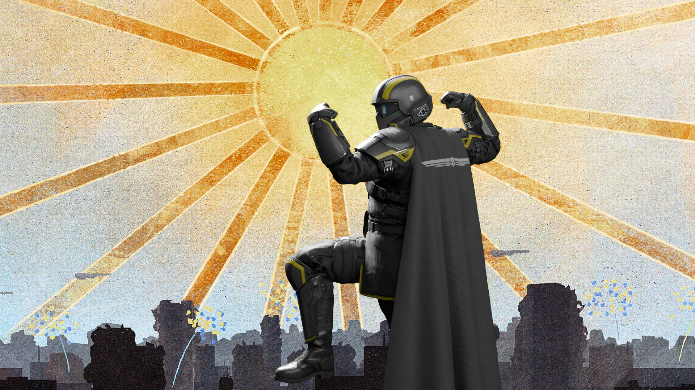
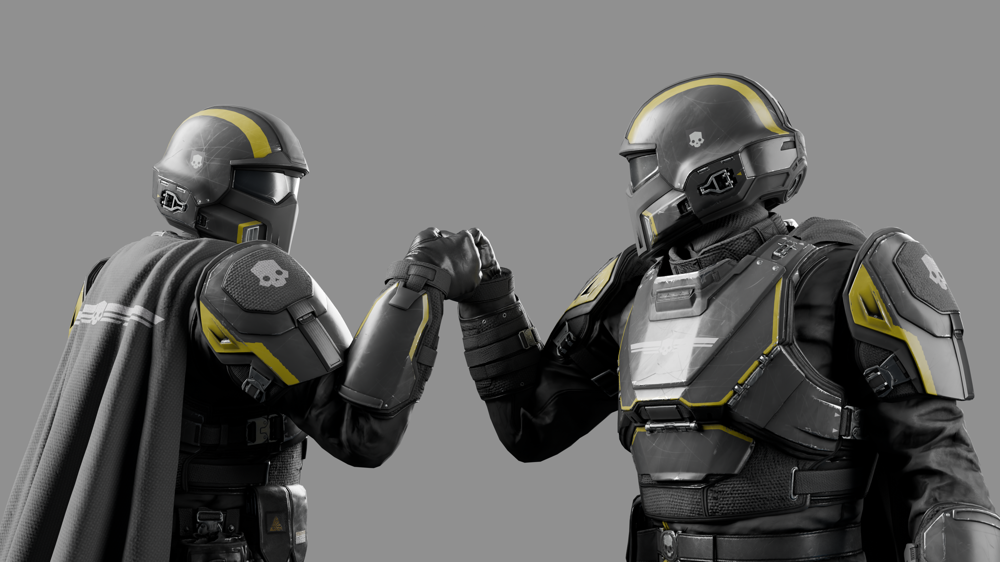
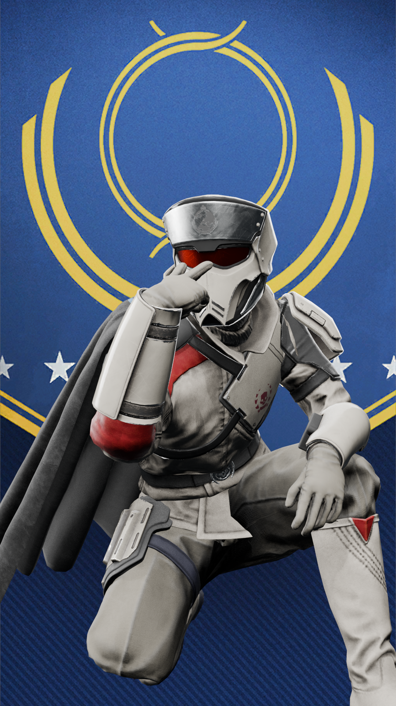
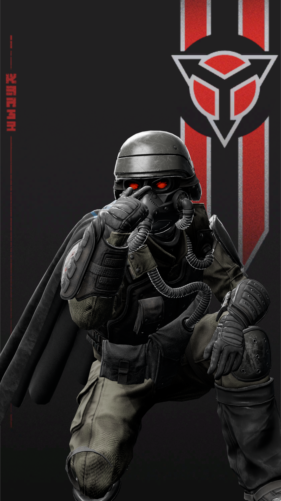

# 开发预览版 0.3 · 成品展示

以下为用户提供的实际出图示例，展示不同角色搭配、动作、画幅和背景效果。

## 单人竖幅

## 单人动作近景

## 背景与姿势组合

## 双人互动

双人动作可结合装备与体型手动微调位置和朝向。

## 玩家卡竖幅

## 另一套角色搭配

[安装图解](QUICK_START.md) · [换装与功能说明](USER_GUIDE.md)。
