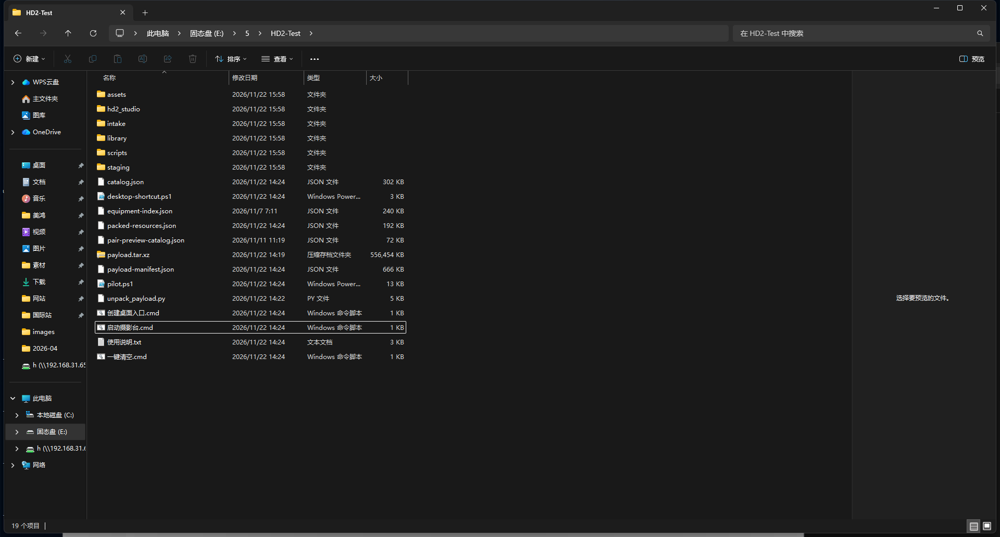
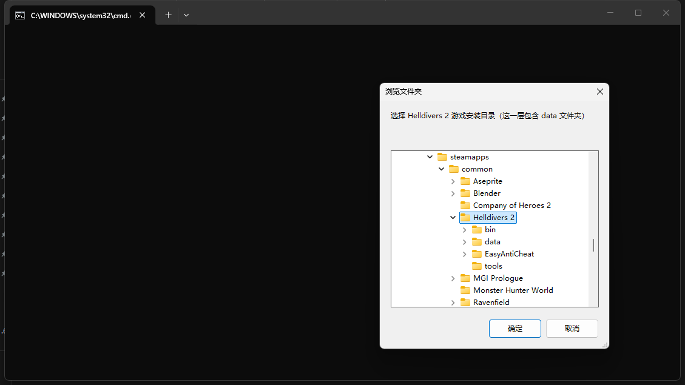
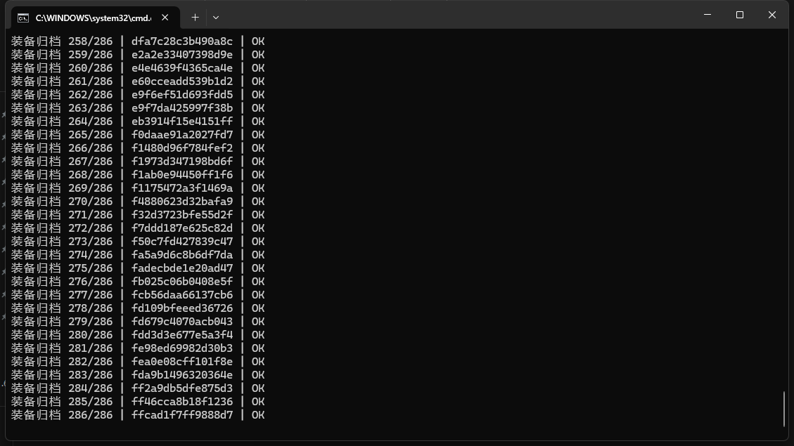
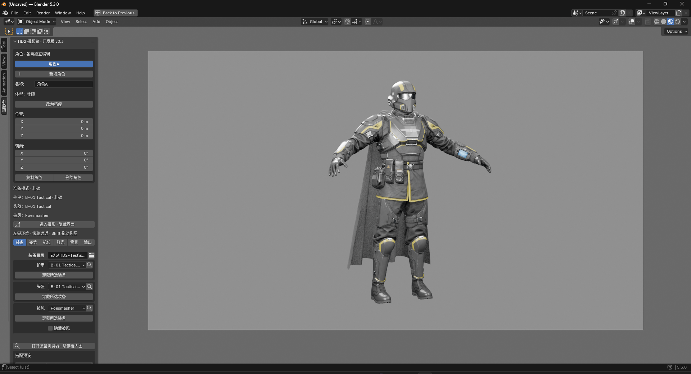
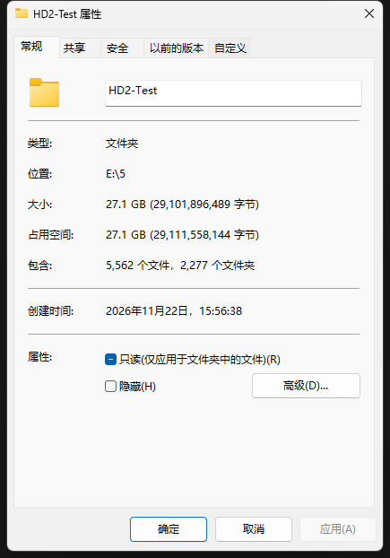

# 开发预览版 0.3 · 安装图解

准备 Windows 版《绝地潜兵 2》和 Blender，为本地资源预留约 30 GiB。既有验收使用 Blender 5.3.0、游戏 Build 26568081。

## 1. 解压并启动

下载 Release 附件 `HD2-Studio-Windows-DevPreview-0.3.0.zip`，完整解压到短且可写的路径，例如 `C:\HD2Studio`。进入 `HD2-Test`，双击 `启动摄影台.cmd`。不要直接在压缩包预览窗口里运行。



## 2. 选择游戏目录

选中包含 `data` 文件夹的 **Helldivers 2 根目录**，不要只选 `data` 本身。若未自动找到 Blender，选择你已安装的 `blender.exe`。



## 3. 等待首次准备

程序会展开随包工具、从游戏生成装备、检查资源并自动试拍。请保持控制台窗口打开。i7-9750H / 16 GB / GTX 1660 Ti 游戏本的实测首次准备约 30–40 分钟，仅作为该平台参考。



## 4. 自动打开摄影台

完成后会自动进入界面并创建桌面入口。之后使用桌面 `HD2 摄影台` 或包内启动入口即可。建议先使用默认的 1080p 快速档出图，较低配置电脑使用 4K 可能需要等待较长时间。



## 空间占用参考

本次演示的准备完成目录约 27.1 GB（29,101,896,489 字节），不是 ZIP 的下载大小。游戏本体、Blender、你另存的工程和输出图片还需要额外空间，建议为本工具预留约 30 GiB。



## 失败重试、移动和清空

失败时先保留日志，修正原因后重新启动，可复用已成功的归档。常规日志目录为 `HD2-Test\staging\test-data\studio\logs`；失败重试时以控制台显示的 `studio-编号` 为准。

移动整份解压目录后，在新位置双击 `创建桌面入口.cmd` 重建快捷方式。

`一键清空.cmd` 会删除本包 `staging\test-data` 下生成的资源、试拍工程、图片、日志和本包 Blender 配置。使用前关闭本包的 Blender，并把需要保留的文件复制到该目录以外。正常使用不需要清空。

## 校验下载

在下载目录打开 PowerShell：

```powershell
Get-FileHash -LiteralPath '.\HD2-Studio-Windows-DevPreview-0.3.0.zip' -Algorithm SHA256
```

预期结果：`69b8b81ac81dff508e34b38f8d07564ce1c10d50a4070598ff782048f7f53439`。

继续阅读：[换装与功能说明](USER_GUIDE.md) · [成品展示](GALLERY.md) · [本版发布说明](RELEASE_NOTES.md)。
