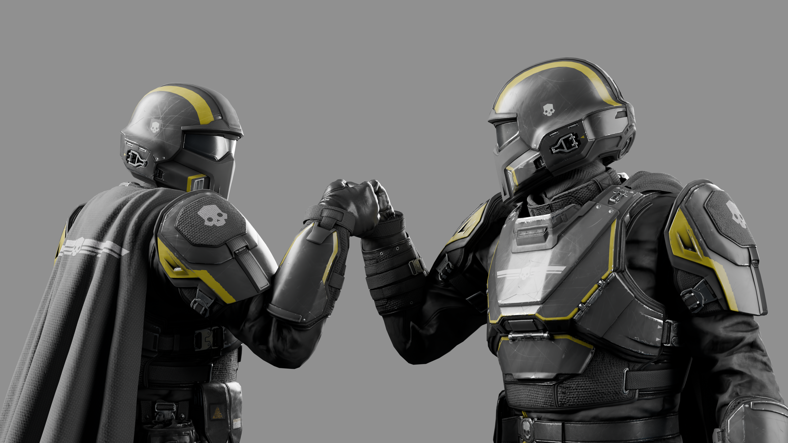

# HD2 Studio · 潜兵摄影台

给自己的潜兵拍张照片。支持《绝地潜兵 2》装备搭配、多角色、动作、背景、灯光和 PNG 输出。

**当前发布准备：开发预览版 0.3（Windows）。** 功能和兼容性仍在完善，欢迎试用反馈。正式下载以本仓库已经发布的 Release 为准。

## 下载和安装

进入 [Releases](https://github.com/SRKMMK/HD2-Studio/releases)，下载 `HD2-Studio-Windows-DevPreview-0.3.0.zip`。请使用安装附件，自动生成的 Source code 压缩包是文档仓库快照。

预先安装游戏与 Windows 版 Blender，预留约 30 GiB。本包完整解压后，进入 `HD2-Test`，双击 `启动摄影台.cmd`，选择游戏根目录及 Blender。首次准备完成后会自动打开摄影台并创建桌面入口。

i7-9750H / 16 GB / GTX 1660 Ti 游戏本实测首次准备约 30–40 分钟；本次演示目录准备完成后约 27.1 GB。该平台使用 4K 出图耗时较长，建议先用 1080p 快速档。

**[安装图解](QUICK_START.md)** · **[换装与功能说明](USER_GUIDE.md)** · **[成品展示](GALLERY.md)** · **[本版发布说明](RELEASE_NOTES.md)**

## 功能

373 条装备、10 组双人互动、80 张玩家卡背景、8 套灯光预设。支持多角色独立编辑、动作播放和定格、搭配模板、工程保存与恢复，以及最高 4K PNG 输出。双人动作遇到穿模时，可手动调整角色位置与朝向。

本仓库目前用于发布安装附件、使用文档和版本指纹，不包含完整可重建的项目源码。

## 反馈

请在 Issues 中提供 Windows / Blender 版本、游戏 Build、操作步骤、预期与实际结果，必要时附截图和去除个人信息的错误日志。
