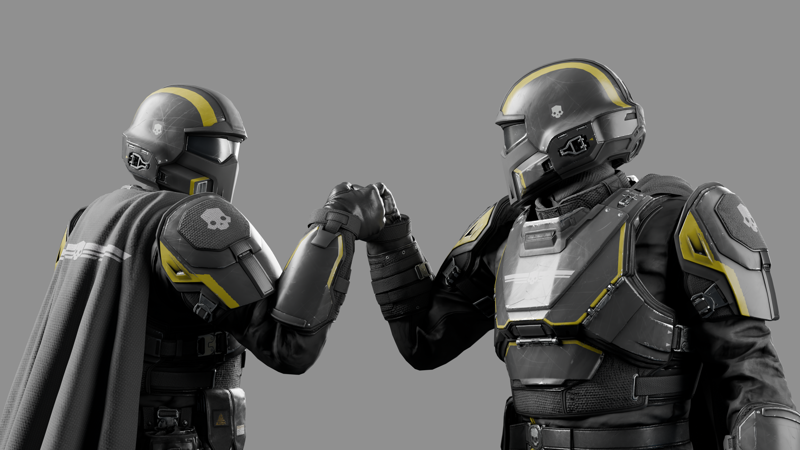
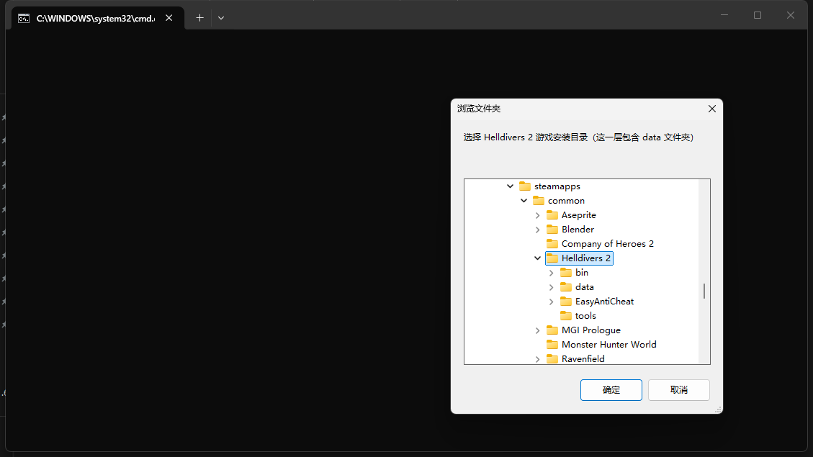
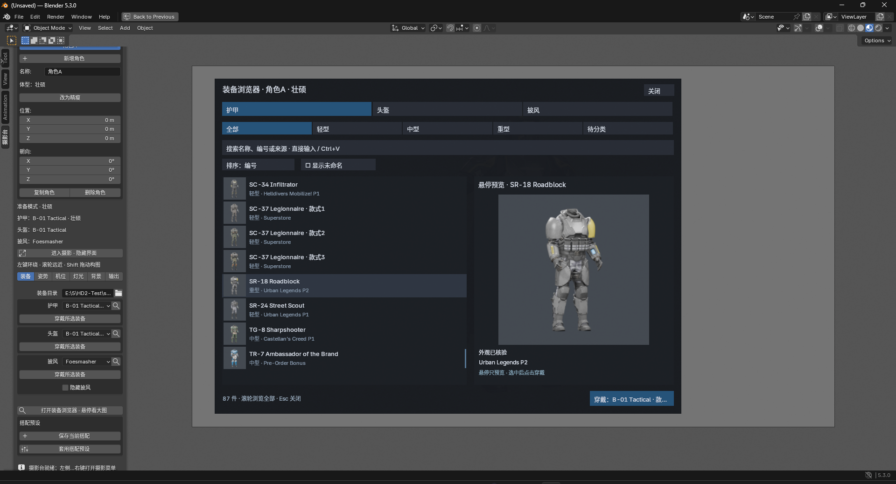
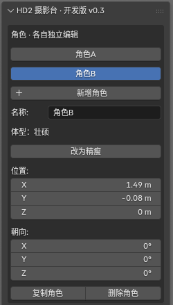

# HD2 摄影台 · 开发预览版 0.3

给自己的潜兵拍张照片：换装、摆动作、调灯光和背景，也可以安排双人互动，输出横屏或竖屏作品。



这是面向 Windows 的开发预览版，功能与兼容性仍在完善。欢迎试用并反馈遇到的问题。

## 下载与首次启动

下载本页附件 **HD2-Studio-Windows-DevPreview-0.3.0.zip**（约 702 MiB）。完整解压后进入 `HD2-Test`，双击 **启动摄影台.cmd**。

请预先安装《绝地潜兵 2》和 Windows 版 Blender，并为本地生成资源预留约 **30 GiB** 空间。选择游戏安装目录时，选包含 `data` 文件夹的 **Helldivers 2 根目录**；若没有自动找到 Blender，再选择 `blender.exe`。

首次启动会从本机游戏准备装备、检查资源并自动试拍。请保持窗口打开，完成后会自动进入摄影台并创建桌面入口。之后可直接从桌面入口启动。



**实测参考：** i7-9750H、16 GB 内存、GTX 1660 Ti 游戏本首次准备约 **30–40 分钟**。演示截图中准备完成后的文件夹约 **27.1 GB**（29,101,896,489 字节）。这些是该测试平台的记录，实际时间和占用会随电脑、游戏及生成内容变化。

**[完整安装图解](https://github.com/SRKMMK/HD2-Studio/blob/main/QUICK_START.md)** · **[换装与功能说明](https://github.com/SRKMMK/HD2-Studio/blob/main/USER_GUIDE.md)** · **[成品展示](https://github.com/SRKMMK/HD2-Studio/blob/main/GALLERY.md)**

GitHub 自动生成的 Source code 压缩包是文档仓库快照，普通使用请下载上面指定的安装附件。本包不包含 Blender；装备模型需在你的电脑上从已安装的游戏生成。

## 可以做什么

- 从 373 条装备中选择护甲、头盔与披风，支持分类、搜索和预览。护甲数量包含壮硕、精瘦体型条目。
- 保存当前搭配为模板，之后直接调用；多角色可以分别换装、切换体型、调整位置和朝向。
- 选择单人动作或摄影定格，播放、暂停、逐帧与定格；支持 10 组双人互动。
- 使用 80 张玩家卡背景、图片、纯色或透明背景，搭配 8 套灯光预设。
- 输出 PNG，默认 1080p 快速，最高可选 4K；支持保存与恢复工程。



装备和动作名称可参考 [Helldivers Wiki：头盔、披风、动作](https://helldivers.wiki.gg/wiki/Cosmetics) 与 [护甲索引](https://helldivers.wiki.gg/wiki/Armor)。对照英文名称查找更方便，译名可能不同。

## 使用提醒与已知问题

- 上述游戏本使用 4K 出图耗时较长，建议先用 **1080p 快速**构图和试拍，确认后再提高画质。这里没有通用的 4K 耗时承诺。
- 双人动作遇到穿模或接触位置不合适时，选中对应角色，手动微调位置与朝向。
- 复杂动作中的披风仍可能穿模，可按需隐藏披风。部分装备的外观仍待进一步核验，持枪动作的武器道具显示尚待完善。
- 本版既有验收使用 Blender 5.3.0、游戏 Build 26568081。其他 Blender 版本、macOS、Linux 和最低硬件配置尚未完成本版验证。
- 两项全库逐帧动画重绑长时回归尚未完成，开发预览版不保证所有装备与所有动作组合都没有问题。



## 校验与反馈

安装包只是更换对外文件名，内容与选定的交付包一致。大小为 **735,734,618 字节**，SHA-256：

```text
69b8b81ac81dff508e34b38f8d07564ce1c10d50a4070598ff782048f7f53439
```

反馈时请提供 Windows / Blender 版本、游戏 Build、操作步骤、预期与实际结果，必要时附截图及去除个人信息的错误日志。常规日志位于 `HD2-Test\staging\test-data\studio\logs`；重试产生的 `studio-编号` 目录以控制台显示为准。
