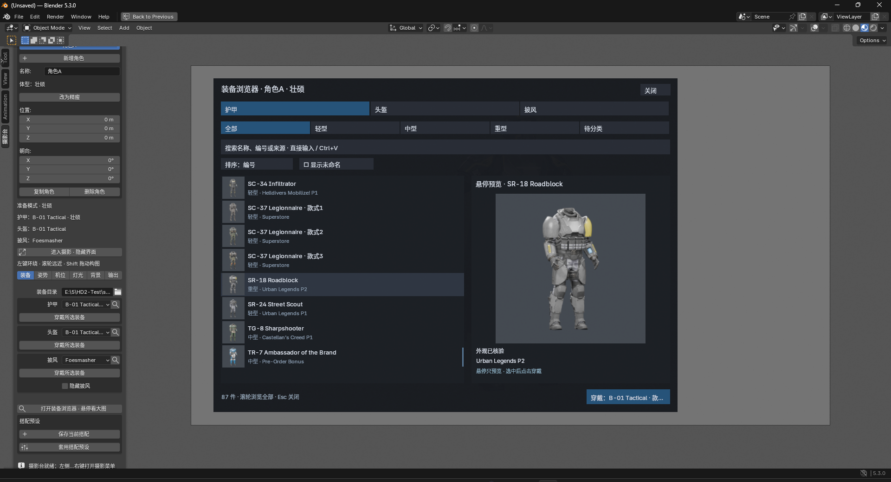
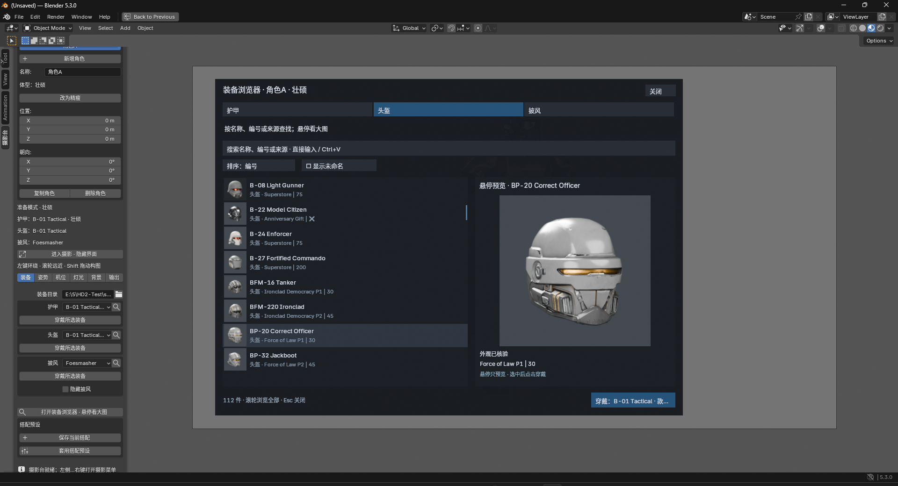
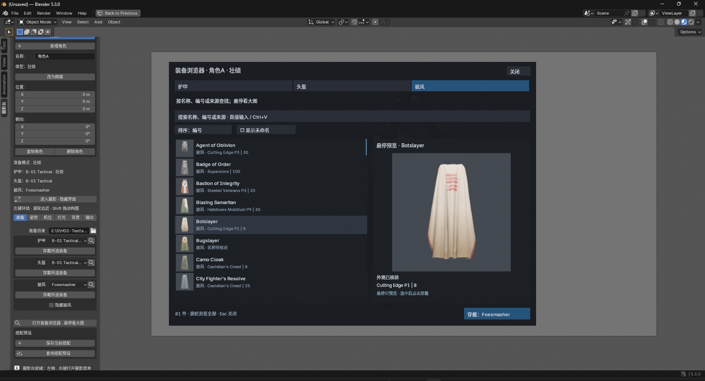
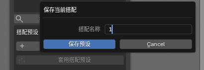
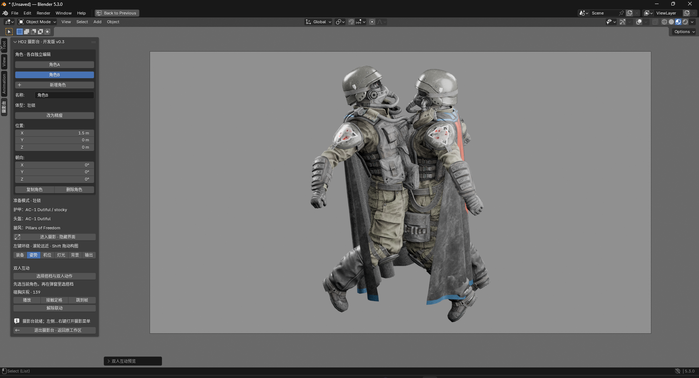
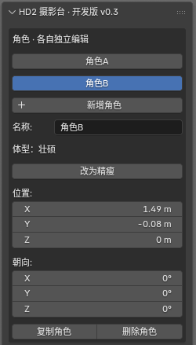

# 开发预览版 0.3 · 换装与功能说明

## 预览并穿戴装备

先选中要编辑的角色，再打开装备浏览器。在护甲、头盔、披风分类中搜索或浏览，确认预览后点击穿戴。装备数量包含护甲的不同体型条目。

名称对照可参考 [Helldivers Wiki 的护甲索引](https://helldivers.wiki.gg/wiki/Armor) 和 [头盔、披风、动作索引](https://helldivers.wiki.gg/wiki/Cosmetics)。软件中的名称与 Wiki 译名可能不同，可结合英文名称查找。

## 保存搭配模板

搭配完成后保存当前搭配，输入方便辨认的名称。后续选择对应预设即可调用，减少重复换装。

## 双人动作

添加第二个角色，分别完成换装，再选择双人互动。可以播放或定格，结合镜头查看两人的接触位置。

## 微调位置与朝向

若出现穿模、身体重叠或手部接触不合适，先选中对应角色，再调整位置 X/Y/Z 与朝向。不同装备、体型和动作需要结合当前画面微调。

## 选择出图画质

先用默认的 1080p 快速档构图和试拍，满意后再提高画质。i7-9750H / 16 GB / GTX 1660 Ti 游戏本的 4K 出图耗时较长，该反馈用于较低配置电脑参考；实际表现随场景和设备变化。

复杂动作可能出现披风穿模，必要时使用隐藏披风选项。更多效果见 [成品展示](GALLERY.md)，其他边界见 [发布说明](RELEASE_NOTES.md)。
